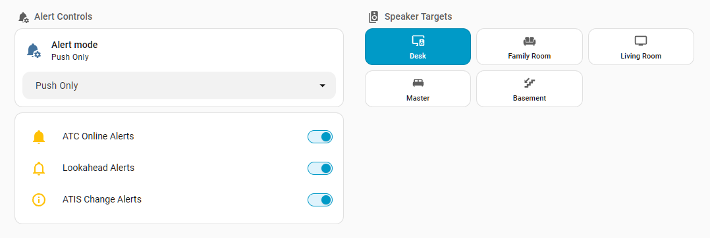

# VATSIM ATC Tracker for Home Assistant

Know when ATC comes online along your route before you call them. This AppDaemon app watches the live VATSIM network for your pilot connection. It publishes Home Assistant entities for your position, the ATC coverage you are in, the sector you are about to enter and when, your filed route drawn on a map, the ATIS at your departure or arrival, and the controller boundaries online right now. Optional spoken and push alerts go where you choose.


*Illustration with sample data, not a capture. The callsign, airports, controllers and coastline are invented.*

---

## Features

**Pilot connection**
- Detects when your VATSIM CID connects and disconnects, with a presence state and last-seen time.
- Publishes your aircraft as a `device_tracker` (callsign, altitude, groundspeed, heading), so any map card can follow you.
- Keeps a session track (breadcrumb trail) of the current connection, broken cleanly when you respawn somewhere else.
- Remembers your last position across restarts, so the map is not blank between flights.

**ATC coverage**
- Tells you whether the airspace you are in is controlled, and by whom (callsign and frequency).
- Centre and FSS boundaries come from the VAT-Spy Client Data Update Project and are downloaded by the app. Approach and departure boundaries are optional and come from a SimAware TRACON Project file you supply. Tower, ground and delivery are not tracked.
- Publishes a GeoJSON layer of every online controller's boundary, plus the sector you are in and the next one.
- Above 18,000 ft (configurable) approach and departure sectors are ignored, so cruise is not cluttered with terminal coverage below you.

**Lookahead**
- Projects your track forward (10 minutes by default) and predicts the next controlled sector, with an ETA and distance.
- Holds the prediction when it would be noise. Below 30 kt, with a heading that moved more than 20 degrees between polls, or with fewer than 3 polls of history, the sensor reports why it skipped. All three thresholds are config keys.

**Route plotting**
- Resolves your filed flight plan against navigation data you supply: fixes, navaids, airways and oceanic lat/lon points are plotted. SID and STAR names and anything else it cannot place are skipped and counted, never guessed.
- Anchors the line at your departure and arrival airports.
- Expands North Atlantic Tracks. A filed `NATD` becomes the oceanic waypoints of the track in force, read from natTrak and refreshed every 30 minutes. An expired track snapshot draws nothing.
- Disambiguates duplicate identifiers by proximity to the previous point on the route.

**Airport ATIS**
- On the ground at your filed departure: the departure ATIS. Airborne and within 100 nm of your arrival: the arrival ATIS. Or type any airport into the ATIS box to pin it, connected or not.

**Alerts** (optional, all switchable from the dashboard)
- ATC online: a controller came online covering your position.
- Lookahead: the next controller ahead, before you reach their airspace.
- ATIS: the letter changed at the airport on the ATIS card (spoken phonetically).
- An alert mode selector (`Disabled`, `Push + Speaker`, `Push Only`, `Speaker Only`) with a one-tap cycle script.
- Per-speaker toggles.
- An optional mute gate: name any on/off entity and VATSIM speech plays only while it reads `off`.



*Illustration with sample data.*

**Health and watchdogs**
- `sensor.vatsim_feed_health` reports feed age, boundary, navdata and NAT track status, the navdata AIRAC cycle and its expiry, and the last refresh errors.
- Watchdog automations notify you when the feed cannot be fetched, the tracker stops publishing, the tracker fails to process the feed, navdata is missing, incomplete or expired, the aircraft position is lost, or a configured mute gate is unavailable. These call the push script directly and ignore the alert mode, so silencing announcements never silences a failure.
- The app verifies on every poll that Home Assistant actually holds what it wrote, and repairs it after a restart.

---

## How it works

```
VATSIM data feed --+
VAT-Spy boundaries +--> AppDaemon app (vatsim_atc_tracker.py) --> HA entities --> packages (alerts, watchdogs)
natTrak (NATs) ----+                                                          +-> dashboard (map, cards)
Your navdata ------+
Your SimAware file +
```

The app runs inside the AppDaemon add-on and writes its entities into Home Assistant's state machine through AppDaemon. No long-lived token or URL is configured. A few consequences follow:

- The entities are **not in the entity registry**. You cannot rename them, give them an area, or change their icon in the UI. They appear in Developer Tools > States once the app has published.
- They **do not exist after a Home Assistant restart** until the app writes them again, normally within one poll (18 seconds). The package's watchdogs use template triggers and tolerate a missing entity for that reason. Write your own automations to tolerate it too: test `states.sensor.vatsim_feed_health is none` or use `has_value()`.
- **Attribute types are not what the code sets.** As written by AppDaemon, an attribute that is `true` arrives as the string `true`, and an attribute that is `false`, `0` or empty is **absent**. In templates, compare with `| string | lower == 'true'`, read counts with `| int(0)`, and never use `is true` or `is false`.

---

## Requirements

| Item | Notes |
|---|---|
| Home Assistant OS or Supervised | Tested on Core 2026.10 |
| AppDaemon add-on | `a0d7b954_appdaemon` from the Home Assistant Community Add-ons repository. Tested on add-on 0.19.3 |
| Python packages (add-on option `python_packages`) | `requests>=2.31`, `shapely>=2.0`, `geopy>=2.4` |
| A VATSIM account | Your CID only. No VATSIM login or API key is used |
| Navigation data | Supplied by you (step 3). Needed for route plotting, the ATIS card's distance logic, and NAT tracks |
| SimAware TRACON boundaries | Optional, supplied by you (step 3). Needed for approach and departure coverage |
| Dashboard cards (HACS) | [button-card](https://github.com/custom-cards/button-card) (tested v7.0.1), [Mushroom](https://github.com/piitaya/lovelace-mushroom) (tested v5.3.0), [map-card](https://github.com/nathan-gs/ha-map-card) (tested v1.16.0) |
| A TTS entity and media players | Only if you want spoken alerts |

---

## Installation

### 1. Install AppDaemon

Settings > Add-ons > Add-on Store > **AppDaemon**. On its Configuration tab, add the three Python packages:

```yaml
python_packages:
  - requests>=2.31
  - shapely>=2.0
  - geopy>=2.4
```

Enable **Start on boot** and **Watchdog**, and start it once so it creates its config folder.

### 2. Copy the app

Copy the folder `apps/vatsim_atc_tracker/` into the AppDaemon apps folder. From the Samba or SSH add-on, that folder is:

```
/addon_configs/a0d7b954_appdaemon/apps/
```

**Path trap.** Inside the AppDaemon container, `/config` is the AppDaemon add-on's own folder, **not** your Home Assistant config. Your Home Assistant config directory is `/homeassistant`. Every path in `apps.yaml` must use the container's view.

### 3. Add your data (optional, but most features want it)

**Navigation data.** The tracker reads X-Plane 12 format files: `earth_fix.dat`, `earth_nav.dat`, `earth_awy.dat`, `earth_aptmeta.dat`. This repository ships no navigation data.

- **Navigraph subscribers:** in Navigraph FMS Data Manager, add an X-Plane 12 entry with a manual path pointing at a folder on your Home Assistant config share, for example `vatsim/navdata`. Run Data Manager again each AIRAC cycle. The tracker notices changed files within the hour and warns you when the cycle expires.
- **Without Navigraph:** copy the same four files from your own X-Plane 12 installation.

**Approach and departure boundaries.** The [SimAware TRACON Project](https://github.com/vatsimnetwork/simaware-tracon-project) keeps one boundary per file, and the tracker reads a single GeoJSON file, so build one on any computer with Python:

```
git clone https://github.com/vatsimnetwork/simaware-tracon-project
python tools/build_simaware.py simaware-tracon-project TRACONBoundaries.geojson
```

Place the result in your config share, for example `vatsim/simaware/`, and point `simaware_boundaries_path` at it. Run the script again to refresh the boundaries. A folder also works as the path, but only its `*.geojson` files are read.

### 4. Configure the app

Add this to `/addon_configs/a0d7b954_appdaemon/apps/apps.yaml`. Only `vatsim_cid` is required. Every option, with its default and unit, is in `apps/vatsim_atc_tracker/apps.yaml.example`.

```yaml
vatsim_atc_tracker:
  module: vatsim_atc_tracker
  class: VatsimAtcTracker
  vatsim_cid: 1234567                  # your VATSIM CID
  navdata_path: /homeassistant/vatsim/navdata
  simaware_boundaries_path: /homeassistant/vatsim/simaware/TRACONBoundaries.geojson
```

Restart the AppDaemon add-on and open its **Log** tab. A healthy start shows, within a minute:

```
Geometry snapshot swapped in (version=1, ...)
Navdata snapshot swapped in (version=1, ..., load_issues=0)
```

A missing or placeholder `vatsim_cid`, or a value that is not a number where one is needed, logs `Configuration error, app not started:` naming the key. A `navdata_path` that holds none of the four files logs an ERROR with the path as the container resolved it.

### 5. Install the Home Assistant packages

Two files: `vatsim.yaml` is the logic and is never edited, `vatsim_user.yaml` holds your settings. A later release replaces the first and leaves the second alone.

1. Enable packages if you have not already. In `configuration.yaml`:
   ```yaml
   homeassistant:
     packages: !include_dir_named packages
   ```
2. Copy `packages/vatsim.yaml` to `/homeassistant/packages/vatsim.yaml`.
3. Copy `packages/vatsim_user.example.yaml` to `/homeassistant/packages/vatsim_user.yaml` and edit its four numbered sections:
   1. speaker toggles: one `input_boolean` per speaker
   2. the optional mute gate entity (leave blank for none)
   3. where pushes go: the default is a sidebar notification; change the action to `notify.mobile_app_<device>` for your phone
   4. your TTS entity and the speaker map (toggle: `media_player`)
4. Back up, then Developer Tools > YAML > **Check configuration**, then restart Home Assistant.

### 6. Add the dashboard

1. Install the three cards through HACS (see Requirements), then hard-refresh the browser.
2. Settings > Dashboards > Add dashboard > **New dashboard from scratch**, named `VATSIM`.
3. Open it, choose Edit dashboard > **Raw configuration editor**, paste in the contents of `dashboard/vatsim_dashboard.yaml`, and save.
4. On the Alerts view, edit the two speaker buttons to match the toggles you defined in `vatsim_user.yaml`.

Dashboard YAML goes into the raw configuration editor only. It never goes in `packages/`.

### 7. Verify

Check Developer Tools > States. The first three rows are true whether or not you are connected.

| Entity | Healthy |
|---|---|
| `sensor.vatsim_feed_health` | state `healthy`; `geometry_status: ready`; `navdata_status: active` (or `disabled` without navdata); `feed_age_seconds` normally under 60 |
| `binary_sensor.vatsim_pilot_connected` | `on` while you are connected, with `cid` matching yours |
| `sensor.vatsim_destination` | `not_connected` when offline |
| `device_tracker.vatsim_aircraft` | has `latitude` and `longitude` once you have connected at least once |
| `sensor.vatsim_flight_route` | state `ok` and no `unresolved_token_count` for a clean route |

---

## Entity reference

All are written by the app. Every entity also carries `friendly_name` and an internal `pub_token`.

| Entity | State | Key attributes |
|---|---|---|
| `sensor.vatsim_feed_health` | `healthy`, `degraded`, `unavailable` | see below |
| `binary_sensor.vatsim_pilot_connected` | `on` / `off` | `presence_state` (`unknown`, `present`, `suspect_missing`, `absent`), `cid`, `last_seen_ts` |
| `binary_sensor.vatsim_atc_coverage` | `on` = controlled | `controller_callsign`, `frequency`, `polygon_id`, `mode` (`CTR`, `APP`, `DEP`), `last_change_reason`, `boundary_geojson` |
| `sensor.vatsim_next_sector` | `differs`, `matches`, `skipped_low_speed`, `skipped_unstable_heading`, `skipped_insufficient_history` | `result_kind` (`different_sector`, `projected_uncontrolled`, `same_sector`, `still_uncontrolled`, or a skip state), `controller_callsign`, `frequency`, `eta_minutes`, `eta_distance_nm`, `eta_text`, `projection_note`, `next_boundary_geojson` |
| `sensor.vatsim_flight_route` | `ok`, `no_flight_plan`, `navdata_unavailable`, `unresolved` | `departure`, `arrival`, `raw_route`, `route_geojson`, `resolved_waypoint_count`, `unresolved_token_count`, `departure_airport_resolved`, `arrival_airport_resolved` |
| `sensor.vatsim_destination` | `departure`, `in_range`, `out_of_range`, `selected`, `at_other_airport`, `no_destination`, `position_unknown`, `not_connected` | `airport`, `role`, `distance_nm`, `range_nm`, `atis_online`, `atis_callsign`, `atis_code`, `atis_frequency`, `atis_text`, `atis_last_updated`, `session` |
| `sensor.vatsim_online_atc_boundaries` | number of boundaries drawn | `controller_count`, `all_boundaries_geojson` |
| `sensor.vatsim_session_track` | `active`, `empty` | `point_count`, `session_started_at`, `points`, `track_geojson` |
| `device_tracker.vatsim_aircraft` | `not_home` | `latitude`, `longitude`, `callsign`, `cid`, `altitude_ft`, `groundspeed_kt`, `heading_deg`, `last_seen_ts`, `session_active` |

The package adds `binary_sensor.vatsim_aircraft_has_position`, which always exists and is `on` once the aircraft has a position. Use it for card visibility.

**Keep the large attributes out of the recorder.** `points` and the GeoJSON attributes are large and change constantly:

```yaml
recorder:
  exclude:
    entities:
      - sensor.vatsim_session_track
      - sensor.vatsim_online_atc_boundaries
      - sensor.vatsim_flight_route
      - sensor.vatsim_next_sector
      - binary_sensor.vatsim_atc_coverage
```

Excluding the last two also removes their history. Leave them in if you want it.

**Feed health attributes.** `last_success_ts`, `consecutive_failures`, `feed_age_seconds`, `timestamp_status` (`ok`, `unknown`, `missing_or_unparseable`, `processing_error`), `geometry_status` (`ready`, `loading`), `geometry_age_seconds`, `last_geometry_refresh_error`, `app_dep_status`, `simaware_load_issue_count`, `navdata_status`, `navdata_cycle`, `navdata_valid_until`, `navdata_load_issue_count`, `last_navdata_refresh_error`, `nat_track_status`, `nat_track_count`, `nat_tracks_in_force`, `nat_track_valid_until`, `last_nat_refresh_error`, `publish_unverified`. Counts that are zero and errors that are unset are absent, so read them with `| int(0)` or test for `none`.

`navdata_status` and `app_dep_status` take `disabled`, `configured_but_unloaded`, `configured_but_empty`, `active`; `navdata_status` also takes `expired` (past the AIRAC validity date; the data is still used).

`nat_track_status` takes:
- `disabled`: no `navdata_path`, or `nat_tracks_url` blank
- `unloaded`: not fetched yet
- `no_tracks_in_force`: normal between the daily westbound and eastbound track windows
- `expired`: deliberately draws nothing
- `active`

---

## Troubleshooting

**Routes do not draw, or `sensor.vatsim_flight_route` is `navdata_unavailable`.** Check `navdata_status` and `last_navdata_refresh_error` on `sensor.vatsim_feed_health`, then the AppDaemon log. The usual cause is `navdata_path` written as `/config/...` instead of `/homeassistant/...`.

**`unresolved_token_count` is high on a route that looks normal.** One or two is expected: SID and STAR names count as unresolved. More than that usually means files from a different simulator's format, or an AIRAC cycle that predates the route.

**A waypoint lands on the wrong continent.** Check that the files are X-Plane 12 format and that `navdata_load_issue_count` is absent or zero.

**The NAT track is missing from an oceanic route.** Check `nat_track_status`. `no_tracks_in_force` and `expired` are both deliberate no-draw states.

**An approach controller is online but coverage reads uncontrolled.** `app_dep_status` must be `active`, which needs `simaware_boundaries_path`. Above `app_dep_altitude_gate_ft` approach sectors are ignored by design.

**Entities are missing after a Home Assistant restart.** Expected until the app's next poll. If they do not come back, check that the AppDaemon add-on is running. The "tracker not publishing" watchdog reports this after 10 minutes.

**I get no spoken alerts.** Check the alert mode, the per-alert toggles, at least one speaker toggle, the speaker map and TTS entity in `vatsim_user.yaml`, and the mute gate if you set one.

---

## Development

```
pip install requests geopy shapely pyyaml
python -m unittest discover -s tests -v      # 28 tests, synthetic navdata, no network
python tools/check_docs.py                   # README names must exist in the code
python tools/pii_scan.py .                   # personal-data scan before a release
python tools/dryrun_compare.py OLD.py NEW.py --apps-yaml apps.yaml --sample-online
python tools/build_simaware.py CLONE OUT     # merge SimAware boundaries into one file
```

`dryrun_compare.py` fetches the public feeds once and shows whether two versions of the app would publish the same states. It writes nothing to Home Assistant.

---

## Privacy

The app reads public VATSIM network data, the public VAT-Spy boundary files, and your local files. It sends nothing about you anywhere: its five outbound requests are plain downloads, identified only by a `User-Agent` naming this project and its version. Your CID stays in your own `apps.yaml`.

Three things on your own system do hold your CID, callsign and position: the entity attributes, the AppDaemon log, and the file `vatsim_last_aircraft.json` next to the app (path configurable with `last_aircraft_path`). Keep them out of screenshots and bug reports.

## License and credits

MIT. See `LICENSE`. Copyright (c) 2026 SavBuilds.

Not affiliated with or endorsed by VATSIM, Navigraph, Laminar Research or SimAware. Network data comes from VATSIM. Boundaries come from the VAT-Spy Client Data Update Project and the SimAware TRACON Project (both CC BY-SA 4.0). NAT tracks come from natTrak. See `THIRD_PARTY_NOTICES.md`.
