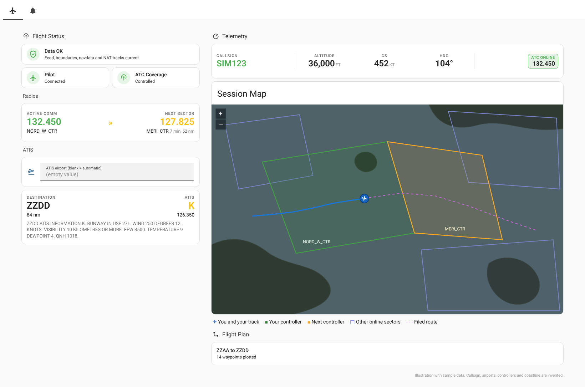

# VATSIM ATC Tracker for Home Assistant

Know when ATC comes online along your route before you call them. This integration follows your VATSIM pilot connection and gives Home Assistant your position, the controller covering you, the sector you are about to enter and when, your filed route as a line on a map, the ATIS at your departure or arrival, and the boundaries of every controller online right now.

It is a custom integration: one install, one setup dialog that asks for your VATSIM CID, no extra Python packages and no add-on.

Needs Home Assistant 2026.10 or later.

**Status: beta (2.0.0b9).** Version 2 is a rewrite of this project as a Home Assistant integration. The tracking logic is the same as version 1, the AppDaemon app, and was compared against it on live data. The Home Assistant side is new. Expect rough edges and please report them.



*Captured in flight on the author's install. The callsign is replaced with a placeholder; nothing else is altered. The ATIS card here shows a METAR, which the dashboard file in this release does not draw yet.*

---

## What you get

**Pilot connection**
- Detects when your CID connects and disconnects, debounced so one missed poll is not a disconnect.
- Your aircraft as a device tracker (callsign, altitude, groundspeed, heading), so any map card can follow it.
- A session track: the breadcrumb trail of the current connection, broken cleanly if you respawn somewhere else.
- Your last position, kept across restarts, so the map is not blank between flights.

**ATC coverage**
- Whether the airspace you are in is controlled, and by whom (callsign and frequency).
- Centre and FSS boundaries come from the VAT-Spy Client Data Update Project, downloaded by the integration. Approach and departure boundaries are optional and come from a SimAware TRACON Project file you supply. Tower, ground and delivery are not tracked.
- A map layer of every online controller's boundary, plus the sector you are in and the next one.
- Above 18,000 ft, approach and departure sectors are ignored, so cruise is not cluttered with terminal coverage below you.

**Lookahead**
- Projects your track forward (10 minutes by default) and predicts the next controlled sector, with an ETA and a distance.
- Holds the prediction when it would be noise: below 30 kt, with a heading still changing, or with too little history. The sensor says why it skipped.

**Route**
- Draws your filed flight plan as a line, resolved against navigation data you supply: fixes, navaids, airways and oceanic lat/lon points. SID and STAR names and anything it cannot place are skipped and counted, never guessed.
- Expands North Atlantic Tracks from natTrak.

**Airport ATIS**
- On the ground at your filed departure: the departure ATIS. Airborne and within 100 nm of your arrival: the arrival ATIS. Or type any airport into the ATIS airport box to pin it, connected or not.
- When the airport has no ATIS online, its METAR, with the flight category.

**Health**
- One diagnostic sensor reports feed age, the state of boundaries, navigation data and NAT tracks, the navigation data cycle and its expiry, and the last errors. Everything fails soft and says so there.
- Problems you should know about are raised as **Repairs** (Settings > System > Repairs) with no setup: the feed cannot be reached or has gone stale, the tracker has stopped, sector boundaries or navigation data did not load, navigation data has expired. Each one says what to check and clears itself when the problem is gone.

---

## Install

**With HACS (or the Home Assistant Marketplace, where your version has it)**

1. Add this repository as a custom repository of type **Integration**: `https://github.com/SavBuilds/vatsim_ha_tracker`
2. Install **VATSIM ATC Tracker** and restart Home Assistant.

**By hand**

1. Copy the folder `custom_components/vatsim_atc` into your Home Assistant `config/custom_components/` folder.
2. Restart Home Assistant.

**Then set it up**

Settings > Devices & services > Add integration > **VATSIM ATC Tracker**, and enter your VATSIM CID. That is the only required setting. No VATSIM login or API key is used.

Within about 20 seconds the device "VATSIM Tracker" shows a feed health of `healthy`.

---

## Optional data

Both are set under the integration's **Configure** button. Paths are as Home Assistant sees them, so a folder on your config share is `/config/...`.

**Navigation data** (for the route line and NAT tracks). The integration reads X-Plane 12 format files: `earth_fix.dat`, `earth_nav.dat`, `earth_awy.dat`, `earth_aptmeta.dat`. This repository ships none.

- Navigraph subscribers: in Navigraph FMS Data Manager, add an X-Plane 12 entry with a manual path pointing at a folder on your Home Assistant config share, for example `vatsim/navdata`. Run it again each AIRAC cycle; the integration notices changed files within the hour.
- Otherwise: copy the same four files from your own X-Plane 12 installation.
- Then set the navigation data folder to, for example, `/config/vatsim/navdata`.

**Approach and departure boundaries.** Build one file from the SimAware TRACON Project on any PC with Python and git. The build script is in this repository, not in what HACS installs, so clone both, side by side:

```
git clone https://github.com/SavBuilds/vatsim_ha_tracker
git clone https://github.com/vatsimnetwork/simaware-tracon-project
python vatsim_ha_tracker/tools/build_simaware.py simaware-tracon-project TRACONBoundaries.geojson
```

Copy `TRACONBoundaries.geojson` to your config share, for example `vatsim/simaware/`, and set the SimAware path to `/config/vatsim/simaware/TRACONBoundaries.geojson`.

The other two options are the lookahead time in minutes and whether to show a METAR when an airport has no ATIS.

---

## Entities

All belong to the device **VATSIM Tracker**. The ids below are the defaults.

| Entity | State | Useful attributes |
|---|---|---|
| `binary_sensor.vatsim_tracker_pilot_connected` | on while your CID is connected | `presence_state` |
| `device_tracker.vatsim_tracker_aircraft` | position | `callsign`, `altitude_ft`, `groundspeed_kt`, `heading_deg`, `session_active`, `last_seen_ts` |
| `binary_sensor.vatsim_tracker_atc_coverage` | on while a controller covers you | `controller_callsign`, `frequency`, `polygon_id`, `boundary_geojson` |
| `sensor.vatsim_tracker_next_sector` | result of the lookahead | `result_kind`, `next_controller_callsign`, `next_frequency`, `eta_text`, `eta_minutes`, `eta_distance_nm`, `next_boundary_geojson` |
| `sensor.vatsim_tracker_destination` | which airport the ATIS card shows | `atis_online`, `atis_code`, `atis_frequency`, `range_nm`, `session`, and the METAR fields |
| `sensor.vatsim_tracker_flight_route` | state of the route line | `departure`, `arrival`, `resolved_waypoint_count`, `unresolved_token_count`, `route_geojson` |
| `sensor.vatsim_tracker_session_track` | state of the track | `point_count`, `track_geojson` |
| `sensor.vatsim_tracker_online_atc_boundaries` | number of controllers drawn | `all_boundaries_geojson` |
| `sensor.vatsim_tracker_feed_health` (diagnostic) | `healthy`, `degraded` or `unavailable` | `geometry_status`, `navdata_status`, `navdata_cycle`, `navdata_valid_until`, `nat_track_status`, `feed_age_seconds`, and the last errors |
| `text.vatsim_tracker_atis_airport` (configuration) | the pinned airport, blank for automatic | |

Things worth knowing when you write automations:

- **Entities are unavailable until first published**, and for up to a minute while the integration reloads with navigation data. A template trigger copes with that; a numeric state trigger set up too early may not.
- **The map layers are not recorded.** The GeoJSON attributes and the track's `points` are large and are kept out of the database by the integration.
- **Attribute types are real**: booleans are booleans and a zero is present.

---

## Dashboard

`dashboard/vatsim_dashboard.yaml` is a ready-made dashboard: status, active and next frequency, ATIS, a session map with the route, the track and the online boundaries.

1. Install three cards (HACS or the Marketplace): [button-card](https://github.com/custom-cards/button-card), [Mushroom](https://github.com/piitaya/lovelace-mushroom), [map-card](https://github.com/nathan-gs/ha-map-card). Hard-refresh the browser.
2. Settings > Dashboards > Add dashboard > New dashboard from scratch.
3. Open it, choose Edit, then the three dots > Raw configuration editor, replace everything with the file's contents, and save.

The second view, **Alerts**, uses helpers from the optional alerts package below. Delete that view if you do not install the package.

The dashboard in this release does not yet draw the METAR on the ATIS card; the attributes are there if you want to add it.

---

## Alerts and watchdogs (optional)

The integration itself only provides entities. `packages/` holds a Home Assistant package that adds:

- spoken and pushed alerts: a controller came online covering you, the next controller ahead, the ATIS letter changed;
- an alert mode (`Disabled`, `Push + Speaker`, `Push Only`, `Speaker Only`), per-speaker switches and an optional mute gate;
- watchdogs that tell you when the feed cannot be fetched, the tracker stops publishing, navigation data is missing or expired, or the aircraft position is lost. These ignore the alert mode, so silencing announcements never silences a failure.

To use it:

1. Enable packages if you have not already. In `configuration.yaml`:
   ```yaml
   homeassistant:
     packages: !include_dir_named packages
   ```
2. Copy `packages/vatsim.yaml` to `config/packages/vatsim.yaml`. Do not edit it.
3. Copy `packages/vatsim_user.example.yaml` to `config/packages/vatsim_user.yaml` and edit its four numbered sections: your speaker switches, the optional mute gate, where pushes go (the default is a notice in the sidebar; change it to `notify.mobile_app_<device>` for your phone), and your TTS entity with the speaker map.
4. Take a backup, then Developer Tools > YAML > Check configuration, then restart.

On a new install the "aircraft position missing" watchdog reports before your first flight, because there is no saved position yet. It clears when you first connect.

---

## Troubleshooting

- **A repair named "VATSIM ..." appeared.** Open it: it says what is wrong and what to check, and it disappears by itself once fixed. Each is raised after a delay, so a slow start or one missed download raises nothing: feed not reachable since start 10 minutes; feed not updating 3 minutes while you are connected and 15 otherwise; tracker stopped 5 minutes; processing, boundary and navigation data failures 5 minutes after the failure, or 30 minutes for a first load that is still running; expired navigation data at once. The delays are counted from when the integration first notices the condition, and it checks every 30 seconds, so a repair can appear up to a minute later than these figures. Reloading the integration clears its repairs, and any that still apply come back after the same delay: something that reloads it every few minutes, such as a "self-healing" automation, keeps them from ever appearing.
- **Feed health is not `healthy`.** Open the entity: the attributes name what is wrong and carry the last error text.
- **No route line.** `navdata_status` on the feed health sensor says whether navigation data is `active`, `disabled` (no folder set), `configured_but_empty` (the folder holds none of the four files) or `expired`.
- **An approach controller alone reads as uncontrolled.** `app_dep_status` is not `active`: no SimAware file is set, or it could not be read.
- **Logs.** Settings > System > Logs, search `vatsim_atc`. For detail, set the integration's log level to debug from its three-dot menu.

---

## Data and privacy

- **What it fetches**, about every 18 seconds while Home Assistant runs: the public VATSIM data feed. Periodically: the VAT-Spy boundary files and natTrak. On demand: a METAR from VATSIM, falling back to aviationweather.gov. Each request carries a User-Agent naming this project. Nothing is sent anywhere else.
- **What it stores**: your CID in the integration's configuration, and your aircraft's last position, callsign and CID in a file under `.storage`. The aircraft tracker's state, including callsign and position, goes into your Home Assistant database like any other entity.
- **Your CID and callsign appear in entity attributes.** Remove them before sharing a screenshot. On VATSIM a callsign, a date and a route are enough to identify the account that flew it.
- VAT-Spy and SimAware boundaries are CC BY-SA 4.0. If you publish a map drawn from them, credit those projects. See `THIRD_PARTY_NOTICES.md`.

---

## Development

The tracking logic is in `custom_components/vatsim_atc/core/engine.py` and has no Home Assistant imports. `host.py` runs it on Home Assistant's event loop: the engine's work happens on one worker thread and never on the loop.

```
python -B -m unittest discover -s tests
```

needs nothing installed. The tests for the Home Assistant side use stand-ins (`tests/ha_stubs.py`), which check the integration against itself, not against Home Assistant.

---

## Coming from version 1 (the AppDaemon app)

Version 1 is still available on the `appdaemon` branch and as the `v1.0.0-rc2` pre-release. It is no longer developed.

Version 2 needs no AppDaemon, no Python packages and no `apps.yaml`. To move over:

1. Install and set up the integration as above. It runs beside the AppDaemon app; the two do not interfere.
2. The entity ids changed: `sensor.vatsim_feed_health` is now `sensor.vatsim_tracker_feed_health`, and likewise for the other eight. `input_text.vatsim_atis_airport` is now `text.vatsim_tracker_atis_airport`. Replace `packages/vatsim.yaml` and the dashboard with the files from this version; your `vatsim_user.yaml` carries over unchanged.
3. Paths change from the AppDaemon container's view (`/homeassistant/vatsim/navdata`) to Home Assistant's (`/config/vatsim/navdata`).
4. Attributes now have real types. A template written for the old quirk, where `true` arrived as a string and `false` or `0` was missing, should be checked.
5. Once a flight looks right, stop the AppDaemon add-on.

---

## Licence

MIT, see `LICENSE`. Not affiliated with or endorsed by VATSIM, Navigraph, Laminar Research or SimAware.
